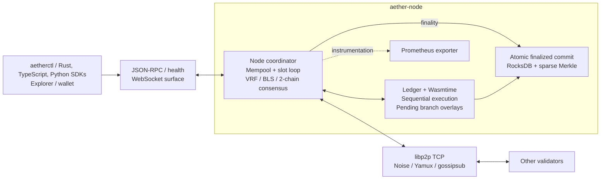

<div align="center">

# Arrha / Aether

**A Rust-first L1 prototype with WASM smart contracts and BFT finality, plus separate libraries for AI verification and agent settlement.**

[](https://github.com/jadenfix/arrha/actions/workflows/ci.yml)
[](LICENSE)
[](https://www.rust-lang.org)

---

**Local validator devnet** &nbsp;&middot;&nbsp; **BFT finality** &nbsp;&middot;&nbsp; **WASM contracts**

</div>

---

## What works today

Arrha is the repository name; Rust packages, binaries, RPC methods, and configuration
still use **Aether**. The runnable product is a local validator network: clients sign
transactions, validators exchange blocks and votes, the ledger executes transfers and
WASM contracts, and certified blocks commit finalized state to RocksDB.

| Surface | Current implementation |
| --- | --- |
| Validator node | VRF leader election, BLS quorum certificates, 2-chain finality, libp2p/TCP peers |
| Execution and storage | Sequential ledger execution, Wasmtime contracts, pending branch overlays, finalized RocksDB and sparse Merkle state |
| Client path | JSON-RPC, `aetherctl chain`, Rust SDK helpers, and TypeScript/Python canonical signed-transfer clients; online signing uses node-reported fees |
| E2E validation | In-process multi-node and settlement-library journeys, plus a four-process devnet journey; client SDK journeys are available and require a live local devnet |
| Separate libraries | AI mesh, TEE/VCR/KZG verification, agent/job escrow, AIC, AMM, governance, DA, QUIC, and firehose are not an assembled node settlement service |

See [architecture](docs/architecture.md) for source-level wiring and
[testing](docs/testing.md) for what each E2E path covers. Deployment manifests and
network presets do not establish an operating public network or production readiness.

## Recorded local measurements

The [benchmark report](docs/benchmarks.md) records a 2026-10-18 run at commit
`ed0961e`: four validator processes on one Apple M4 laptop over localhost.
These are historical measurements of that revision, not fresh results for every checkout.

| Metric | Recorded result |
| --- | --- |
| Slot / finalized block cadence | 500 ms slots; one finalized block every 1.03 s on average |
| Submit-to-finality at 100 transfers/s | p50 1.6 s, p95 4.6 s, p99 6.2 s |
| Sustained load before large queues | About 400 transfers/s or 100 WASM counter calls/s |
| One validator stopped | Remaining three kept finalizing; restarted validator resumed finalization in 1.8 s |

The report includes raw artifacts, method, and limitations. It does not measure WAN
latency, a large validator population, Byzantine load, or production usage. Reproduce
with `./scripts/bench/run-benchmarks.sh`; that script starts and resets local devnets.

## Architecture



See [Architecture](docs/architecture.md) for the source audit and integration boundaries.

## Key Features

### Hybrid Consensus
VRF-based leader election, HotStuff-style BFT voting and BLS aggregate signatures. Blocks outside the genesis/bootstrap exception require a parent quorum certificate (>= 2/3 stake); a block is final when it and its child in the immediately following slot are both certified (2-chain rule; single-validator mode finalizes its own certificate). Blocks execute on in-memory pending state and are written to RocksDB only when final, so competing unfinalized branches do not overwrite finalized state.

Protocol v2 uses a fixed genesis committee. Economic slashing changes bonded
stake but does not reconfigure consensus membership. Existing node/indexer
state needs a fresh v2 network; see [migration instructions](docs/migrations/protocol-v2.md).

### WASM Smart Contracts
Wasmtime-powered VM with fuel metering, bounded memory and sandboxed execution; contracts are deployed and called with ordinary transactions and their storage is committed to the state root. A read/write-set scheduler for parallel execution exists in `crates/runtime` but block execution is currently sequential.

### Ledger
The ledger implements account transfers, UTxO transactions, WASM deployment and calls, and fee handling. Pending blocks execute against branch overlays; finalized changes are persisted atomically. The current block execution path is sequential.

### AI Verification Pipeline
The intended flow is AIC job escrow → TEE execution → VCR/KZG verification → challenge window → settlement. Mesh, verifier, and program libraries exist, but the node does not assemble this end-to-end flow; the old print-only AI runtime executable has been removed. See [integration boundaries](docs/architecture.md#components-outside-the-assembled-node-path).

### Dual Token Economy
The token design assigns **SWR** to staking, governance, and validator rewards, and **AIC** to compute credits, job escrow, and worker payments. AIC and AMM libraries exist separately; this does not establish live exchange or AI settlement through the node.

### On-Chain Programs
The repository contains staking, governance, AMM, job escrow, reputation, AIC token, and account abstraction libraries. Staking is used by the node; the ledger transaction path handles transfers, UTxOs, and WASM deploy/call, rather than dispatching all these libraries as native programs.

### Turbine Data Availability
Turbine and Reed-Solomon erasure-coding libraries exist. The running node currently broadcasts whole blocks through libp2p/TCP; it does not wire these libraries into block propagation.

### Observability
The node starts a Prometheus exporter and provides structured tracing and RPC health/readiness endpoints. Grafana deployment assets are available separately. The gRPC firehose remains an in-process broadcast library. The standalone indexer polls finalized blocks from a configured node RPC, pins the chain identity and latest-block checkpoint in RocksDB, and serves persisted block summaries; it does not index pending execution.

## Independent settlement product

The [EVM settlement package](settlement/README.md) adds signed agent-work
escrow on existing EVM networks without depending on this L1. Local deployed
contract, SDK, persistent-service and browser E2E journeys are implemented.
Public testnet, independent review, mainnet, Solana and Bitcoin remain separate
open gates; this is not a production launch.

## Quick Start

**Prerequisites:** current stable Rust with Cargo, a C/C++ compiler and libclang for RocksDB, Git, Bash, curl, and Python 3. Node.js 20+ and npm are optional for web/TypeScript builds. Workspace package metadata declares Rust 1.86; CI follows stable Rust. See [Getting Started](GETTING_STARTED.md) for setup.

### Run a local devnet (4 validators)

```bash
git clone https://github.com/jadenfix/arrha.git
cd arrha
./scripts/devnet.sh start      # builds, runs the genesis ceremony, starts 4 validator processes
./scripts/devnet.sh status     # finalized slot, peers, mempool per validator
```

`start` stops the managed devnet and **deletes its previous data directory** before
creating a fresh chain. It builds `aether-node` in release mode, generates validator keys and a shared
`genesis.json` (4 validators plus 256 funded devnet accounts), starts four separate
processes that dial each other over libp2p, and waits until blocks finalize. Validator *i*
serves JSON-RPC on `8545+i-1`, P2P on `9000+i-1` and metrics on `9100+i-1`. Logs and
per-validator consensus event logs are in `data/devnet/`.

```bash
./scripts/devnet.sh kill 3     # stop validator 3 (the other 3 keep finalizing)
./scripts/devnet.sh restart 3  # it rejoins and catches up
```

### Accounts, transfers and a WASM contract

```bash
cargo build --release -p aether-cli
CTL=./target/release/aetherctl

ALICE=$($CTL keys generate --out alice.json | python3 -c 'import json,sys; print(json.load(sys.stdin)["address"])')
$CTL chain transfer --dev 0 --to "$ALICE" --amount 5000000000 --wait
$CTL chain account "$ALICE"                                 # finalized and pending state
CONTRACT=$($CTL chain deploy --key alice.json examples/contracts/counter.wat --wait | python3 -c 'import json,sys; print(json.load(sys.stdin)["contract"])')
$CTL chain call --key alice.json --contract "$CONTRACT" --u64 6 --wait
$CTL chain storage "$CONTRACT"                              # {"0x636f756e74": "0x0600000000000000"}
$CTL chain blocks --last 20                                 # proposer, QC signers, finality
```

`--dev <i>` signs with deterministic, publicly known devnet accounts funded at genesis
(local networks only). Amounts are integer ledger units. The example creates `alice.json` in the current
directory; keep the generated key if you need to reuse that account. The same flow
is available from the Rust SDK
(`aether_sdk::chain`: `transfer_tx`, `deploy_tx`, `call_tx`, `send_transaction`,
`wait_for_finality`).

### End-to-end test

Stop the quick-start network before the E2E journey claims the same ports.
The launcher’s `stop` preserves its data; use `clean` separately only when you
intend to delete that managed devnet data.

```bash
./scripts/devnet.sh stop
./scripts/e2e-devnet.sh
```

Starts 4 validators and checks initial finality on each; after the crash/rejoin
journey it compares a common finalized block hash on validators 1 and 4. A new
account is funded and transfers; the counter contract deploys and two calls set it to 7
(read from a different validator); finalized blocks carry 3-of-4 quorum certificates;
with one validator killed the rest keep finalizing; after a restart it catches up.
The script uses fixed RPC ports 8545–8548 and a disposable `data/e2e-devnet` directory,
which it removes on exit unless `KEEP_DEVNET_DATA=1` is set. Stop any other network
using those ports first. CI configures
this on every pull request (`Devnet E2E` job). See [testing](docs/testing.md) for all retained E2E journeys.

### JSON-RPC

With a validator running, JSON-RPC provides methods including `aeth_getSlotNumber`, `aeth_getFinalizedSlot`, `aeth_getBlockByNumber`,
`aeth_sendRawTransaction`, and `aeth_getNodeInfo`, `aeth_getBlockSummaries`
(proposer, parent QC signers, finalized flag and times), `aeth_getTransactionStatus`,
`aeth_sendRawTransactions`, `aeth_getPendingAccount` and `aeth_getContractStorage`.

```bash
curl -s localhost:8545 -H 'Content-Type: application/json' \
  -d '{"jsonrpc":"2.0","method":"aeth_getNodeInfo","params":[],"id":1}'
```

### TypeScript and Python clients

The browser apps and SDKs use the node's JSON-RPC endpoint. From the repository
root, install the web workspace and build the SDK/apps with Node.js 20+ and npm:

```bash
npm ci
npm run build:web
```

With a local four-validator devnet running, exercise each SDK by creating a
temporary signing key, funding it with the local CLI, submitting a canonical
signed raw transfer, waiting for successful finality, and checking the recipient
balance through validator 3:

```bash
npm run e2e:client
python3 -m venv work/python-sdk-venv
work/python-sdk-venv/bin/python -m pip install --upgrade pip setuptools wheel
work/python-sdk-venv/bin/python -m pip install ./sdks/python
work/python-sdk-venv/bin/python scripts/client-e2e.py
```

These journeys need `target/release/aetherctl` and RPC ports 8545 and 8547. Set
`AETHER_RPC_FROM`, `AETHER_RPC_READ`, or `AETHERCTL_BIN` to use other endpoints or
the CLI path. The scripts report `PASS` only after Rust accepts the signed raw
transaction and the second validator reports the exact finalized balance change.
The TypeScript `npm run dev:explorer` and `npm run dev:wallet` commands serve the
apps on `127.0.0.1:3000` and `127.0.0.1:3001`; the wallet signs locally in the
current tab and is scoped to a local/devnet workflow. An explorer status marked
unavailable means that its configured RPC read failed; it is not a zero-valued
measurement. Neither app invents validator, stake, uptime, or job data.

### Benchmarks

```bash
cargo build --release -p aether-node -p aether-cli -p aether-loadgen --bins
./scripts/bench/run-benchmarks.sh
```

See [docs/benchmarks.md](docs/benchmarks.md).

## Project Structure

```
crates/                 Rust workspace
  node/                 Validator binary (entry point)
  consensus/            VRF-PoS + HotStuff + BLS aggregation
  ledger/               eUTxO++ state transitions
  runtime/              WASM VM (wasmtime), parallel scheduler
  mempool/              Fee-priority tx pool, QoS
  p2p/                  libp2p networking
  networking/           Separate QUIC and gossip libraries (outside node P2P path)
  da/                   Turbine, erasure coding, shreds
  crypto/               Ed25519, VRF, BLS, KES, KZG
  state/                Sparse Merkle, RocksDB, snapshots
  programs/             Node staking plus separate governance, AMM, escrow, AIC libraries
  verifiers/            TEE, KZG, VCR validators
  rpc/                  Node JSON-RPC; separate in-process firehose library
  types/                Shared types (Block, Transaction, Address)
  tools/                aetherctl, keytool, faucet, scorecard, indexer, loadgen
ai-mesh/               Off-chain AI libraries: router, coordinator, worker
sdks/                  TypeScript and Python SDKs
apps/                  Explorer and wallet
deploy/                Docker, Helm, k8s, Terraform, Prometheus, Grafana
scripts/               Lint, E2E launcher, devnet, benchmarks
fuzz/                  Libfuzzer targets (tx, block, merkle, VRF, WASM)
docs/                  Architecture, security, operations
```

## Development

```bash
cargo build --workspace                     # Debug build
cargo build --release                       # Release build
./cli-test                                # E2E journeys + real process devnet
cargo clippy --all-targets --all-features -- -D warnings  # Lint
./scripts/lint.sh                           # fmt, Clippy, workspace check
./scripts/test.sh                           # Alias for ./cli-test
```

### CLI

```bash
cargo run -p aether-cli --bin aetherctl -- --help
```

## Documentation

| Document | Description |
|---|---|
| [Architecture](docs/architecture.md) | System design and component interactions |
| [Getting Started](GETTING_STARTED.md) | Contributor bootstrap and local workflows |
| [Contributing](CONTRIBUTING.md) | PR standards and validation flow |
| [Security](docs/security/AUDIT_SCOPE.md) | Audit scope and security model |
| [Agent Settlement](docs/ecosystem/aether-agent-settlement.md) | Ecosystem settlement scope and compatibility design |
| [Runbooks](docs/ops/RUNBOOKS.md) | Operational procedures |
| [Roadmap](IMPLEMENTATION_ROADMAP.md) | Delivery plan and milestones |

## Ecosystem and settlement design

Arrha belongs to the [jadenfix/ecosystem](https://github.com/jadenfix/ecosystem)
family. Its validator node runs independently of sibling repositories.

The proposed ecosystem role is settlement for agent work: signed job requests,
receipts, verifier decisions, challenge handling, and escrow outcomes. The repository
contains schemas and settlement libraries, with in-process library E2E coverage.
The running node does not expose an integrated AI job API or execute the entire
TEE → VCR → challenge → payment flow. Receipt anchoring and sibling-project
consumers remain integration work unless a producer and consumer are implemented
and exercised together.

Use the existing JSON-RPC and signed chain path for node integration today. See
[Agent Settlement](docs/ecosystem/aether-agent-settlement.md) for contract scope,
remaining integration work, and completion criteria.

## Contributing

Contributions are welcome across the entire stack -- protocol, tooling, AI mesh, frontend, and documentation. See [CONTRIBUTING.md](CONTRIBUTING.md) for guidelines.

## License

MIT License -- Copyright (c) 2026 Aether Foundation. See [LICENSE](LICENSE) for details.
