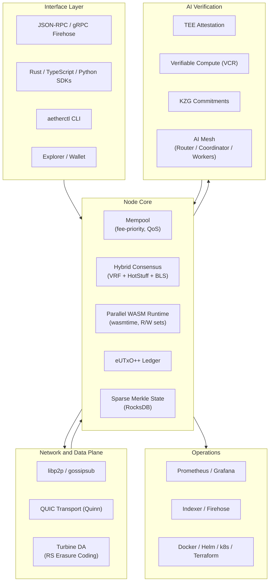

<div align="center">

# Aether

**A Rust-first L1 blockchain with AI-native verification, WASM smart contracts, and BFT finality.**

[](https://github.com/jadenfix/arrha/actions/workflows/ci.yml)
[](LICENSE)
[](https://www.rust-lang.org)
[](crates/)

---

**Parallel Execution** &nbsp;&middot;&nbsp; **BFT Finality** &nbsp;&middot;&nbsp; **AI Verification** &nbsp;&middot;&nbsp; **Dual Token Economy**

</div>

---

## Measured on a local devnet

Numbers below are **measured**, not targets: 4 validator processes on **one Apple M4
laptop over localhost** (2026-10-18, commit `ed0961e`). Method, raw data and caveats are
in [docs/benchmarks.md](docs/benchmarks.md); reproduce with
`./scripts/bench/run-benchmarks.sh`.

| | Aether local devnet (measured) |
|---|---|
| Slot length / block cadence | 500 ms slots; one finalized block every 1.03 s on average |
| Time to finality (submit to final) | p50 1.6 s, p95 4.6 s, p99 6.2 s at 100 tx/s |
| Sustained throughput | ~400 transfers/s; ~100 WASM contract calls/s (all finalized, none lost) |
| One of four validators killed | kept finalizing (29 blocks in 30.6 s); rejoined and finalized again 1.8 s after restart |
| BLS verification | 2,111 sig/s one at a time, 12,324 sig/s batched (5.8x) |

### Next to Bitcoin and Solana, with caveats

This is **not a like-for-like comparison**: Aether's column is a single-machine,
4-validator localhost devnet with no WAN latency, no adversaries and no real users;
Bitcoin and Solana are global production networks. It does **not** show that Aether is
faster than Solana in production.

| | Aether (local devnet) | Bitcoin mainnet | Solana mainnet |
|---|---|---|---|
| Block / slot time | 500 ms slots, a finalized block every ~1 s | 10 min average by design[^btcwiki]; 9.7 min measured over 4,443 blocks, 2026-09-18 to 10-18[^mempool] | ~400 ms nominal[^soldocs]; 217 ms measured over the last 20,000 slots on 2026-10-18[^solrpc] |
| Finality | deterministic, p50 1.6 s / p95 4.6 s at 100 tx/s | probabilistic; 6 confirmations (~60 min) is the common convention[^btcwiki] | "finalized" ~31 slots behind "confirmed", ~6.7 s measured 2026-10-18[^solrpc]; docs: 32 slots, ~13 s at 400 ms slots[^soldocs] |
| Throughput | ~400 tx/s transfers on one laptop | 8.1 tx/s average (6.2 to 10.4 by day), 2026-09-18 to 10-14[^btctxs] | 1,887 non-vote tx/s (4,955 incl. votes), hour average on 2026-10-18[^solrpc] |
| Validators / setting | 4, one machine | global | global |

What this shows: the code runs as a real multi-process BFT network, finalizes
deterministically, executes WASM contracts, survives a crashed validator and lets it
rejoin. What it does not show: behaviour over a WAN, with many validators, under
Byzantine or adversarial load, or with real users. Aether's throughput here is capped by
its block gas limit and by VRF leader election leaving about half of the slots without a
finalized block, not by the hardware.

[^btcwiki]: Bitcoin Wiki, "Confirmation", https://en.bitcoin.it/wiki/Confirmation (accessed 2026-10-18).
[^mempool]: mempool.space REST API, block at timestamp for 2026-09-18 and 2026-10-18 (heights 967,564 and 972,007), https://mempool.space/docs/api/rest (accessed 2026-10-18).
[^btctxs]: Blockchain.com, confirmed transactions per day, https://www.blockchain.com/explorer/charts/n-transactions (30-day series ending 2026-10-14, accessed 2026-10-18).
[^soldocs]: solana.com docs, "Transaction confirmation and expiration", https://solana.com/docs/core/transactions/confirmation (accessed 2026-10-18).
[^solrpc]: Solana mainnet-beta public RPC (`getRecentPerformanceSamples`, `getBlockTime`, `getSlot` per commitment), queried 2026-10-18; method docs at https://solana.com/docs/rpc.

## Architecture



## Key Features

### Hybrid Consensus
VRF-based leader election, HotStuff-style BFT voting and BLS aggregate signatures. Every block carries a quorum certificate (>= 2/3 stake) for its parent; a block is final when it and its child in the next slot are both certified (2-chain rule). Blocks execute on in-memory pending state and are written to RocksDB only when final, so forks never corrupt state.

### WASM Smart Contracts
Wasmtime-powered VM with fuel metering, bounded memory and sandboxed execution; contracts are deployed and called with ordinary transactions and their storage is committed to the state root. A read/write-set scheduler for parallel execution exists in `crates/runtime` but block execution is currently sequential.

### eUTxO++ Ledger
Extended UTXO model combining Bitcoin's security properties with Ethereum's programmability. Deterministic fee estimation and natural parallelism.

### AI Verification Pipeline
End-to-end verifiable AI compute: jobs escrowed with AIC tokens, executed in TEEs, verified via VCR proofs with KZG polynomial commitments, and settled on-chain with challenge windows.

### Dual Token Economy
**SWR** for staking, governance, and validator rewards. **AIC** for AI compute credits, job escrow, and mesh worker payments. On-chain AMM for seamless exchange.

### On-Chain Programs
Staking, governance, AMM, job escrow, reputation scoring, AIC token, and account abstraction -- all built as native system programs.

### Turbine Data Availability
Reed-Solomon erasure-coded block propagation inspired by Solana's Turbine. Shred-based distribution for high throughput and fault tolerance.

### Full Observability
Prometheus metrics, Grafana dashboards, structured tracing spans, health check endpoints, and gRPC firehose for real-time indexing.

## Quick Start

**Prerequisites:** Rust 1.86+ &nbsp;|&nbsp; Python 3 (for the e2e script) &nbsp;|&nbsp; Node.js 20+ (optional, for web/SDKs)

### Run a local devnet (4 validators)

```bash
git clone https://github.com/jadenfix/arrha.git
cd arrha
./scripts/devnet.sh start      # builds, runs the genesis ceremony, starts 4 validator processes
./scripts/devnet.sh status     # finalized slot, peers, mempool per validator
```

`start` builds `aether-node` in release mode, generates validator keys and a shared
`genesis.json` (4 validators plus 256 funded devnet accounts), starts four separate
processes that dial each other over libp2p, and waits until blocks finalize. Validator *i*
serves JSON-RPC on `8545+i-1`, P2P on `9000+i-1` and metrics on `9100+i-1`. Logs and
per-validator consensus event logs are in `data/devnet/`.

```bash
./scripts/devnet.sh kill 3     # stop validator 3 (the other 3 keep finalizing)
./scripts/devnet.sh restart 3  # it rejoins and catches up
./scripts/devnet.sh clean      # stop everything and delete the devnet data
```

### Accounts, transfers and a WASM contract

```bash
cargo build --release -p aether-cli
CTL=./target/release/aetherctl

$CTL keys generate --out alice.json                         # new account
$CTL chain transfer --dev 0 --to <alice-address> --amount 5000000000 --wait
$CTL chain account <alice-address>                          # finalized and pending state
$CTL chain deploy --key alice.json examples/contracts/counter.wat --wait   # prints the contract address
$CTL chain call --key alice.json --contract <contract> --u64 6 --wait
$CTL chain storage <contract>                               # {"0x636f756e74": "0x0600000000000000"}
$CTL chain blocks --last 20                                 # explorer view: proposer, QC signers, finality
```

`--dev <i>` signs with deterministic, publicly known devnet accounts funded at genesis
(local networks only). The same flow is available from the Rust SDK
(`aether_sdk::chain`: `transfer_tx`, `deploy_tx`, `call_tx`, `send_transaction`,
`wait_for_finality`).

### End-to-end test

```bash
./scripts/e2e-devnet.sh
```

Starts 4 validators and asserts: all finalize and agree on the finalized chain; a new
account is funded and transfers; the counter contract deploys and two calls set it to 7
(read from a different validator); finalized blocks carry 3-of-4 quorum certificates;
with one validator killed the rest keep finalizing; after a restart it catches up. CI runs
this on every pull request (`Devnet E2E` job).

### JSON-RPC

Standard methods (`aeth_getSlotNumber`, `aeth_getFinalizedSlot`, `aeth_getBlockByNumber`,
`aeth_sendRawTransaction`, ...) plus `aeth_getNodeInfo`, `aeth_getBlockSummaries`
(proposer, parent QC signers, finalized flag and times), `aeth_getTransactionStatus`,
`aeth_sendRawTransactions`, `aeth_getPendingAccount` and `aeth_getContractStorage`.

```bash
curl -s localhost:8545 -H 'Content-Type: application/json' \
  -d '{"jsonrpc":"2.0","method":"aeth_getNodeInfo","params":[],"id":1}'
```

### Benchmarks

```bash
cargo build --release -p aether-node -p aether-cli -p aether-loadgen --bins
./scripts/bench/run-benchmarks.sh
```

See [docs/benchmarks.md](docs/benchmarks.md).

## Project Structure

```
crates/                 Rust workspace (53 crates)
  node/                 Validator binary (entry point)
  consensus/            VRF-PoS + HotStuff + BLS aggregation
  ledger/               eUTxO++ state transitions
  runtime/              WASM VM (wasmtime), parallel scheduler
  mempool/              Fee-priority tx pool, QoS
  p2p/                  libp2p networking
  networking/           QUIC transport (Quinn), gossipsub
  da/                   Turbine, erasure coding, shreds
  crypto/               Ed25519, VRF, BLS, KES, KZG
  state/                Sparse Merkle, RocksDB, snapshots
  programs/             Staking, governance, AMM, escrow, reputation
  verifiers/            TEE, KZG, VCR validators
  rpc/                  JSON-RPC, gRPC firehose
  types/                Shared types (Block, Transaction, Address)
  tools/                aetherctl, keytool, faucet, indexer, loadgen
ai-mesh/               Off-chain AI: router, coordinator, workers
sdks/                  TypeScript and Python SDKs
apps/                  Explorer and wallet
deploy/                Docker, Helm, k8s, Terraform, Prometheus, Grafana
scripts/               Lint, test, devnet, acceptance suites
fuzz/                  Libfuzzer targets (tx, block, merkle, VRF, WASM)
docs/                  Architecture, security, operations
```

## Development

```bash
cargo build --workspace                     # Debug build
cargo build --release                       # Release build
cargo test --all-features --workspace       # Run the full test suite
cargo clippy --all-targets --all-features -- -D warnings  # Lint
./scripts/lint.sh                           # Full CI lint flow
./scripts/test.sh                           # Full CI test flow
```

### CLI

```bash
cargo run -p aether-cli --bin aetherctl -- --help
```

## Documentation

| Document | Description |
|---|---|
| [Architecture](docs/architecture.md) | System design and component interactions |
| [Getting Started](GETTING_STARTED.md) | Contributor bootstrap and local workflows |
| [Contributing](CONTRIBUTING.md) | PR standards and validation flow |
| [Security](docs/security/AUDIT_SCOPE.md) | Audit scope and security model |
| [Agent Settlement](docs/ecosystem/aether-agent-settlement.md) | Ecosystem settlement scope and compatibility design |
| [Runbooks](docs/ops/RUNBOOKS.md) | Operational procedures |
| [Roadmap](IMPLEMENTATION_ROADMAP.md) | Delivery plan and milestones |

## Ecosystem

Aether is part of the [jadenfix/ecosystem](https://github.com/jadenfix/ecosystem) family of Rust-first, local-first agent infrastructure. It remains fully standalone: a complete L1 with its own consensus, runtime, ledger, SDKs, and tooling. No sibling repository is required for Aether's core value or operation.

Within the ecosystem, Aether's role is frontier settlement. It communicates with sibling projects through explicit protocol artifacts rather than shared internals:

- **Compute settlement:** agent runtimes can submit signed jobs, receipts, verifier outputs, and challenge results through Aether's TEE + VCR verification lane, with escrow settled on-chain.
- **Attestation anchoring:** beaterOS receipts, beater attestations, and beater-memory provenance can be anchored as transactions or events when both sides ship the matching consumer.
- **Ecosystem read path:** tempo, beatbox, beater.js, SDKs, dashboards, and agents should consume finalized blocks, JSON-RPC responses, gRPC firehose streams, receipts, and verifier events instead of linking to node internals.
- **Integration rule:** every connection stays opt-in and contract-bound. A roadmap-only dependency does not become part of Aether's public contract until a real producer and consumer exist on both sides.

See [Agent Settlement](docs/ecosystem/aether-agent-settlement.md) for the detailed compatibility scope, gap analysis, dependency graph, and definition of done.

## Contributing

Contributions are welcome across the entire stack -- protocol, tooling, AI mesh, frontend, and documentation. See [CONTRIBUTING.md](CONTRIBUTING.md) for guidelines.

## License

MIT License -- Copyright (c) 2026 Aether Foundation. See [LICENSE](LICENSE) for details.
