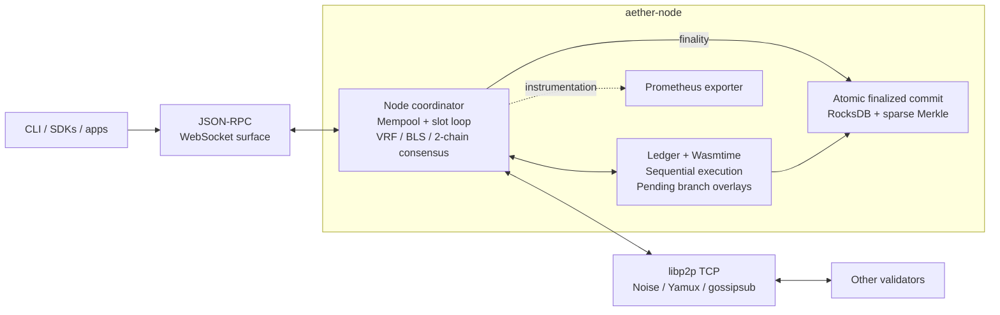

# Arrha / Aether architecture

Source audit: **2026-10-18**, against `main` at
`390dd0c5180f1ccf59b1e31ac62dc965383e67a4` (PR #412).
Arrha is the repository name; Rust packages, binaries, and protocol names still use Aether.
This audit describes that baseline plus this cleanup: the print-only AI runtime, unused feature-gate registry, and obsolete test/phase assets have been removed. It is not a production qualification.

## Running node and component boundaries

Solid arrows describe assembled node connections; dotted arrows show instrumentation.
Separate library components are listed below the diagram, with their integration boundaries.

## Transaction and finality path

1. `NodeRpcBackend` submits signed transactions to `Node::submit_transaction`
   (or the batch variant). The mempool validates and orders transactions;
   the slot loop flushes local transaction gossip every 20 ms. Peer transactions
   enter through the network-event handler.
2. Wall-clock slots drive VRF leader eligibility and block proposals. The node
   executes candidate transactions against the selected parent's state, which may
   itself be a pending branch. Received proposals are also executed and their
   state and receipt roots checked before acceptance.
3. `Ledger::apply_block_on` verifies transaction signatures in a batch and then
   applies transactions **sequentially**. Transfers, UTxO updates, and WASM
   deployment/calls use overlays. `WasmExecutor` supplies Wasmtime with fuel,
   memory limits, and contract storage. The parallel read/write-set scheduler
   exists in the runtime crate but is not used in this block path.
4. The consensus engine validates votes and stake-weighted BLS quorum
   certificates (at least two-thirds stake). The binary constructs
   `HybridConsensus` in `hybrid_node.rs`. Its `try_commit_parent_of` finalizes
   the certified parent only when the certified child occupies the immediately
   following slot. A gap does not satisfy this **2-chain rule**. The single-validator
   mode treats its own certificate as final. The unused standalone HotStuff,
   VRF-PoS, and round-robin engines have been removed to avoid parallel rules.
5. Pending state stays in memory until finality. `finalize_through` and
   `commit_finalized` commit the finalized branch through `Ledger::commit_pending`,
   combining state changes, block/receipt data, metadata, and staking persistence
   in an atomic RocksDB batch. Pending branches are not written as finalized state.
6. JSON-RPC exposes finalized and pending views, transaction status, blocks,
   accounts, and contract storage. Callers must distinguish included from finalized.

## Source map

| Boundary | Implementation evidence |
| --- | --- |
| Binary assembly, RPC backend, slot/P2P loops, WASM adapter | [`crates/node/src/main.rs`](../crates/node/src/main.rs) |
| Transaction ingress, proposal validation, pending branches, finalized commits | [`crates/node/src/node.rs`](../crates/node/src/node.rs) |
| Sequential ledger execution and atomic state persistence | [`crates/ledger/src/state.rs`](../crates/ledger/src/state.rs) |
| Quorum arithmetic and 2-chain finality | [`crates/consensus/src/lib.rs`](../crates/consensus/src/lib.rs), [`hybrid.rs`](../crates/consensus/src/hybrid.rs) |
| TCP/Noise/Yamux transport and gossipsub | [`crates/p2p/src/network.rs`](../crates/p2p/src/network.rs) |
| Network messages and decoding | [`crates/node/src/network_handler.rs`](../crates/node/src/network_handler.rs) |
| HTTP/WS routing | [`crates/rpc/json-rpc/src/server.rs`](../crates/rpc/json-rpc/src/server.rs) |
| Runtime integration dependencies | [`crates/node/Cargo.toml`](../crates/node/Cargo.toml), [`crates/ledger/Cargo.toml`](../crates/ledger/Cargo.toml) |

## Interfaces and observability

- The binary starts JSON-RPC, P2P, slot processing, and a Prometheus exporter.
- JSON-RPC defaults to loopback port 8545, with `/health`, POST JSON-RPC,
  and `/ws`; P2P listens on TCP port 9000; metrics default to port 9090.
- The four-process devnet overrides these to RPC 8545–8548, P2P 9000–9003,
  and metrics 9100–9103; see [`scripts/devnet.sh`](../scripts/devnet.sh).
- CLI, SDKs, explorer, and wallet live in separate packages. Their presence does
  not imply every client method or screen has been verified against a running node.

## Components outside the assembled node path

| Component | Current integration boundary |
| --- | --- |
| Parallel scheduler (`crates/runtime`) | Library exists; node ledger block execution is sequential. |
| QUIC, Turbine, erasure coding (`crates/networking`, `crates/da`) | Separate libraries; the binary uses `aether-p2p` over TCP and broadcasts whole blocks. Shred events are recognized but the node decoder returns no node message for them; there is no reassembly integration in this path. |
| gRPC firehose (`crates/rpc/grpc-firehose`) | `FirehoseServer` currently wraps an in-process Tokio broadcast channel. The node does not start a gRPC firehose listener. |
| Indexer (`crates/tools/indexer`) | Query/store/ingestion code exists, but its executable creates its own local firehose rather than connecting to a node. Do not draw a live finalized-block feed to it. |
| AI mesh and TEE/VCR/KZG verifiers | Separate service/library code; The print-only AI runtime executable has been removed. The node does not assemble an end-to-end attested inference and settlement service. |
| Native program crates | Staking logic is used by the node. Other program libraries must not be represented as a universal node dispatch path: ledger contract dispatch explicitly handles deploy/call IDs, with transfer and UTxO handling alongside it. |
| Agent settlement / sibling projects | The [ecosystem design](ecosystem/aether-agent-settlement.md) describes intended compatibility and gaps. Verify matching producer and consumer implementations before treating a bridge as active. |

This distinction corrects the earlier context diagram, which grouped JSON-RPC
with gRPC and P2P with QUIC/DA, and implied all of them formed one running pipeline.

## Deployment and verification surfaces

- **Single local process:** `cargo run -p aether-node --bin aether-node`;
  without a genesis file the binary uses a single-validator configuration.
- **Local multi-process devnet:** `scripts/devnet.sh` builds and launches four
  validators with a common genesis and real libp2p connections.
- **Compose assets:** `docker-compose.test.yml` and
  `deploy/docker/docker-compose.yml` describe test/development environments.
  Asset presence alone does not prove successful startup or service integration.
- **Infrastructure scaffolding:** `deploy/helm`, `deploy/k8s`, and
  `deploy/terraform` are deployment assets, not evidence of a deployed network.

The current [CI definition](../.github/workflows/ci.yml) includes formatting,
Clippy, a dependency audit (allowed to fail), in-process E2E, TypeScript workspace builds, Linux release builds, a Docker image build, scoped in-process node
integration tests, and a four-process devnet E2E job. The devnet script checks
finality, transfers, WASM contracts, validator loss, and restart/catch-up.
The integration job no longer brings up Compose; obsolete phase acceptance scripts have been removed. The workflow does not publish artifacts or deploy a network.
See [testing](testing.md) for the E2E-only suite and its evidence limits.

The README's benchmark results are explicitly a four-process, single-machine
local devnet. WAN operation, adversarial security, hardware attestation, public
network operation, and complete AI settlement require separate evidence.

## Keeping this diagram current

When node assembly, ledger dispatch, transports, finality, persistence, or CI
changes, update this document and the README overview in the same change. Trace
connections from the binary entrypoint and call sites; a workspace member or a
crate's name is insufficient evidence that a service is running.
