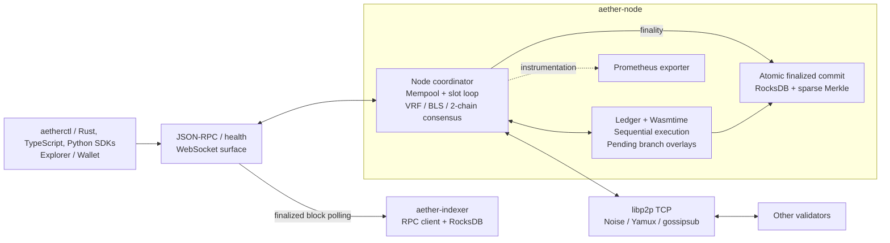

# Arrha / Aether architecture

Source audit: **2026-10-19**, including the protocol-v2 and delivery repairs
after the cleanup in PR #413 and documentation audit in PR #414. The diagram
traces the executable assembly below; it is not a production qualification.
Arrha is the repository name; Rust packages, binaries, and protocol names still use Aether.
The baseline removes the print-only AI runtime, unused feature-gate registry,
alternative consensus engines, and obsolete test/phase assets. This is a source
map, not a production qualification.

## Running node and component boundaries

Solid arrows describe assembled node connections; dotted arrows show instrumentation.
Separate library components are listed below the diagram, with their integration boundaries.

## Transaction and finality path

1. `NodeRpcBackend` submits signed transactions to `Node::submit_transaction`
   (or the batch variant). The mempool validates and orders transactions;
   the slot loop flushes local transaction gossip every 20 ms. Peer transactions
   enter through the network-event handler.
2. Wall-clock slots drive VRF leader eligibility and block proposals. The node
   executes candidate transactions against the selected parent's state, which may
   itself be a pending branch. Received proposals are also executed and their
   state and receipt roots checked before acceptance. Proposals normally require
   a parent QC; the validation bootstrap exception is `slot <= 1` or a zero
   parent hash (`Node::on_block_received`).
3. `Ledger::apply_block_on` verifies transaction signatures in a batch and then
   applies transactions **sequentially**. Transfers, UTxO updates, and WASM
   deployment/calls use overlays. `WasmExecutor` supplies Wasmtime with fuel,
   memory limits, and contract storage. The parallel read/write-set scheduler
   exists in the runtime crate but is not used in this block path.
4. The consensus engine validates votes and stake-weighted BLS quorum
   certificates (at least two-thirds stake). The binary constructs
   `HybridConsensus` in `hybrid_node.rs`. Its `try_commit_parent_of` finalizes
   the certified parent only when the certified child occupies the immediately
   following slot. A gap does not satisfy this **2-chain rule**. The single-validator
   mode treats its own certificate as final. The unused standalone HotStuff,
   VRF-PoS, and round-robin engines have been removed to avoid parallel rules.
5. Pending state stays in memory until finality. `finalize_through` and
   `commit_finalized` commit the finalized branch through `Ledger::commit_pending`,
   combining state changes, block/receipt data, metadata, and staking persistence
   in an atomic RocksDB batch. Pending branches are not written as finalized state.
6. Protocol v2 keeps the genesis consensus committee fixed. Economic slashes
   update stake, but do not reconfigure consensus membership; finalized on-chain
   committee reconfiguration is not implemented. Rewards for crossed epochs,
   completed unbondings, slashing effects, transaction execution, and fee
   distribution are computed on the candidate's parent branch. Credits are
   applied before fees, and the header state root plus receipt state roots are
   captured after all block effects. The overlay is adopted only when finalized.
   Epoch randomness still advances in the slot loop; it does not directly
   mutate account balances there.
   V2 block IDs bind the header and slash evidence with a domain-separated
   hash; a certificate cannot be reused after evidence is changed.
7. JSON-RPC exposes finalized and pending views, transaction status, blocks,
   accounts, and contract storage. Callers must distinguish included from finalized.

## Source map

| Boundary | Implementation evidence |
| --- | --- |
| Binary assembly, RPC backend, slot/P2P loops, WASM adapter | [`crates/node/src/main.rs`](../crates/node/src/main.rs) |
| Transaction ingress, proposal validation, pending branches, finalized commits | [`crates/node/src/node.rs`](../crates/node/src/node.rs) |
| Sequential ledger execution and atomic state persistence | [`crates/ledger/src/state.rs`](../crates/ledger/src/state.rs) |
| Quorum arithmetic and 2-chain finality | [`crates/consensus/src/lib.rs`](../crates/consensus/src/lib.rs), [`hybrid.rs`](../crates/consensus/src/hybrid.rs) |
| TCP/Noise/Yamux transport and gossipsub | [`crates/p2p/src/network.rs`](../crates/p2p/src/network.rs) |
| Network messages and decoding | [`crates/node/src/network_handler.rs`](../crates/node/src/network_handler.rs) |
| HTTP/WS routing | [`crates/rpc/json-rpc/src/server.rs`](../crates/rpc/json-rpc/src/server.rs) |
| Runtime integration dependencies | [`crates/node/Cargo.toml`](../crates/node/Cargo.toml), [`crates/ledger/Cargo.toml`](../crates/ledger/Cargo.toml) |

## Interfaces and observability

- The binary starts JSON-RPC, P2P, slot processing, and a Prometheus exporter.
- JSON-RPC defaults to loopback port 8545, with process liveness at `/health`,
  finality readiness at `/ready`, POST JSON-RPC, and `/ws`; container/operator
  deployments opt into a non-loopback bind with `AETHER_RPC_BIND_IP`. P2P
  listens on TCP port 9000; metrics default to port 9090.
- The four-process devnet overrides these to RPC 8545–8548, P2P 9000–9003,
  and metrics 9100–9103; see [`scripts/devnet.sh`](../scripts/devnet.sh).
- The P2P loop retries up to 32 configured bootstrap targets in rotation,
  attempting one target every five seconds. Connected and in-flight dials are
  suppressed, bans still apply, and one bounded OS DNS lookup can occur per
  tick. A late or restarted seed can reconnect without restarting its followers.
- CLI, Rust/TypeScript/Python SDKs, explorer, and wallet connect directly to
  node JSON-RPC. The optional four-process devnet client journey exercises
  signed transfers through the TypeScript and Python SDKs across validators;
  it does not exercise every method or verify every explorer and wallet screen.

## Components outside the assembled node path

| Component | Current integration boundary |
| --- | --- |
| Parallel scheduler (`crates/runtime`) | Library exists; node ledger block execution is sequential. |
| QUIC, Turbine, erasure coding (`crates/networking`, `crates/da`) | Separate libraries; the binary uses `aether-p2p` over TCP and broadcasts whole blocks. Shred events are recognized but the node decoder returns no node message for them; there is no reassembly integration in this path. |
| gRPC firehose (`crates/rpc/grpc-firehose`) | `FirehoseServer` currently wraps an in-process Tokio broadcast channel. The node does not start a gRPC firehose listener. |
| Indexer (`crates/tools/indexer`) | Separate executable polls a configured node's JSON-RPC finalized slot and full blocks, writes them to RocksDB, verifies chain identity and the persisted block checkpoint on reconnect, and serves `/status` plus `/block/{slot}`. The node binary and validator Compose graph do not start it. |
| AI mesh and TEE/VCR/KZG verifiers | Separate service/library code. The TEE verifier rejects non-simulation reports because certificate-chain verification is unimplemented. The print-only AI runtime executable was removed; no end-to-end attested inference/settlement service is assembled. |
| Native program crates | Staking logic is used by the node. Other program libraries must not be represented as a universal node dispatch path: ledger contract dispatch explicitly handles deploy/call IDs, with transfer and UTxO handling alongside it. |
| Agent settlement / sibling projects | The [ecosystem design](ecosystem/aether-agent-settlement.md) describes intended compatibility and gaps. Verify matching producer and consumer implementations before treating a bridge as active. |

Agent-run escrow and account-abstraction are reusable libraries, not native
ledger dispatch targets in this binary. `AgentRunEscrowState` keeps accounting
maps; authenticating callers, actual token debits, persistence and atomic
settlement require integration beyond those maps.

## Deployment and verification surfaces

- **Single local process:** `cargo run -p aether-node --bin aether-node`;
  without a genesis file the binary uses a single-validator configuration.
- **Local multi-process devnet:** `scripts/devnet.sh` builds and launches four
  validators with a common genesis and real libp2p connections.
- **Compose assets:** `docker-compose.test.yml` and
  `deploy/docker/docker-compose.yml` use one shared-genesis four-validator
  full-mesh container journey and a real RPC transfer runner. They do not run
  the standalone indexer or establish an operator deployment.
- **Infrastructure scaffolding:** `deploy/helm`, `deploy/k8s`, and
  `deploy/terraform` are deployment assets, not evidence of a deployed network.

The current [CI definition](../.github/workflows/ci.yml) includes formatting,
Clippy, dependency auditing that fails on unexcepted vulnerabilities, unsound
advisories, and yanked crates while leaving unmaintained advisories visible,
in-process E2E, TypeScript workspace and app builds, Linux release builds, a real
Compose container journey, and a four-process devnet journey with TypeScript and
Python client transfers plus an indexer restart check.
These are configured checks, not evidence that they passed on a particular
revision. The workflow does not publish release artifacts or deploy a network.
See [testing](testing.md) for the E2E-only suite and its evidence limits.

The README's benchmark results are explicitly a four-process, single-machine
local devnet. WAN operation, adversarial security, hardware attestation, public
network operation, and complete AI settlement require separate evidence.

## Keeping this diagram current

When node assembly, ledger dispatch, transports, finality, persistence, or CI
changes, update this document and the README overview in the same change. Trace
connections from the binary entrypoint and call sites; a workspace member or a
crate's name is insufficient evidence that a service is running.
