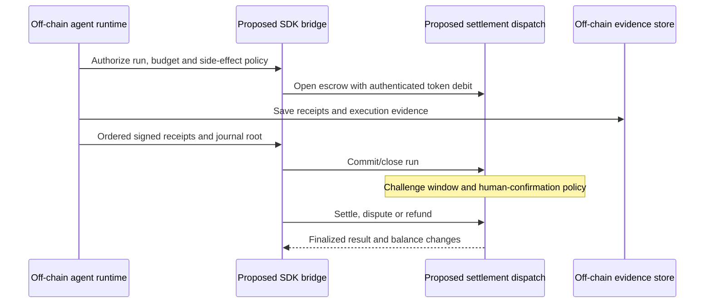

# Arrha / Aether agent settlement design

Reviewed **2026-10-18** against implementation baseline `b5460e8` (PR #413).
Arrha is the repository name; Aether remains the package/protocol name. This
records implemented library boundaries and the proposed ecosystem integration.
Sibling repositories have not been audited by this document update.

## Current implementation

The [running node](../architecture.md) supports VRF/BLS consensus, sequential
ledger/WASM execution, finalized persistence and JSON-RPC over a local
four-validator devnet. It does not dispatch agent-run escrow or account
abstraction as an integrated native settlement service.

| Boundary | Repository implementation | Evidence limit |
| --- | --- | --- |
| Wire schema | `crates/agent-schema`: signature envelopes, authorizations, step receipts, journal roots/proofs, payments and JSON Schema export | Structural validation and wire types are distinct from verifying every advertised signature algorithm. |
| Signing and identity | `crates/sdk/rust/src/agent_identity.rs`, `agent_builder.rs`; ML-DSA and FROST libraries | Local signing/verification helpers; no deployed agent identity registry or sibling enrollment proof. |
| Policy | `crates/programs/account-abstraction`: bounded authorization, payment binding and guardian approval checks | In-process entrypoint state; not a universal ledger-native program dispatch path. |
| Escrow | `crates/programs/agent-run-escrow`: run budgets, receipts, journal roots, challenge windows, disputes/refunds | In-memory accounting maps. Caller authentication, actual balance debit/credit, persistence and transaction atomicity require integration. |
| Payment clients | Rust SDK and `sdks/typescript` payment helpers | Helpers are not a live paid HTTP service or a proven sibling bridge. |
| AI verification | TEE/VCR/KZG libraries | Non-simulation TEE reports are refused because certificate-chain verification is unimplemented; no hardware-attested inference journey is established. |
| Indexing | Indexer and local firehose libraries | Indexer executable creates its own local firehose. No assembled remote finalized-block feed. |

The retained cross-library journey is:

```bash
cargo test -p aether-sdk --test agent_settlement_e2e
```

It exercises authorization, signing, policy, receipts and escrow transitions in
one process. The [E2E testing guide](../testing.md) distinguishes that journey
from four-process node networking and deployed settlement. Neither test family
proves a sibling producer/consumer bridge or actual AIC settlement over RPC.

## Intended ecosystem boundary

Agents execute off-chain; the chain should hold minimal commitments, escrow
balances and dispute outcomes. Full journals, browser observations, tool
transcripts and evaluation datasets remain off-chain with explicit retention
and access policies. A signed hash proves its binding and signer, not the
correctness of a browser action or the user's consent.

The proposed consumers are beater.js (agent runs), tempo (browser steps), beatbox
(sandbox results), beater (evaluation attestations) and a future OS policy layer.
These are design roles, not verified descriptions of their current APIs. Bridge
work must check both repositories at pinned revisions.

The economic design uses SWR for staking/governance and AIC for work accounting.
Token/program libraries do not establish a live token market, deployed AMM,
public network or tradable assets. Extending AIC accounting from inference to
runs/actions remains a product and integration choice.

## Shared contract and remaining gaps

Use the existing `aether-agent-schema` as the wire source of truth rather than
copying abbreviated pseudostructures into bridges. Its concrete types include
`SignatureEnvelope`, `AgentAuthorization`, `StepReceipt`, `JournalRoot`,
`SettlementPolicy` and `PaymentEnvelope`. Preserve canonical encoding, domains,
chain id, signed payload binding, receipt order and payment replay scope.

Existing `SideEffect` values are Read, Draft, Write, Send, Purchase and Delete.
Account policy requires guardian authorization for high-risk actions. Alignment
with a sibling's confirmation/idempotency semantics still needs cross-repo
conformance evidence; matching enum names alone is insufficient.

Remaining integration work:

1. Freeze/export the actual schema and demonstrate identical producer/consumer
   serialization and signature verification in a cross-repo E2E journey.
2. Define an authenticated node dispatch and persistence boundary for account
   policy and agent escrow, with actual token balance movement in atomic state
   transitions. Do not expose library accounting as paid settlement prematurely.
3. Define run lifecycle mapping. Current escrow statuses are `Running`, `Closed`,
   `NeedsReview`, `Disputed`, `Settled` and `Refunded`; they are not identical to
   an agent runtime's completed/failed statuses.
4. Connect a real bridge to JSON-RPC with signed, replay-protected actions,
   deterministic retries and recovery after uncertain responses.
5. Qualify disputes, human confirmation, cancellation and timeout refunds
   together with evidence availability and actual economic balances.
6. Add a real finalized-block ingestion source before indexing settlement
   events or advertising explorer run search.

## Proposed settlement journey



The library offers `open_run`, `commit_step`, `close_run`, dispute, confirmation,
settlement and refund transitions; the diagram's network interactions remain
proposed. The bridge must translate library API arguments and statuses rather
than assuming these names are existing RPC methods.

A production bridge must retain an operation id and submitted transaction hash,
distinguish inclusion from finality, and resume safely after a process crash.
An uncertain send/purchase/delete must enter review rather than replaying an
external side effect solely because payment acknowledgement was lost.

## Verification and policy choices

| Step | Proposed evidence | Open qualification |
| --- | --- | --- |
| LLM inference | Attestation result, VCR commitment, challenge evidence | Implement hardware certificate verification and complete a real worker-to-settlement journey. |
| Tool/API call | Signed receipt, request/result hashes and service identity | Bind exact request, quote, result, nonce, expiry and payment; define who can arbitrate external semantics. |
| Browser action | Receipt, observation hash and retained session evidence | User intent, confirmation, privacy and irreversible-action recovery. |
| Deterministic sandbox | Signed result and execution/fuel/config commitment | Reproducibility and dispute replay; optional future zkVM proofs. |
| High-risk action | Bounded session authorization plus guardian approval | Persist spend/nonce state and prove that policy is enforced at the actual effect/settlement boundary. |

Side-effect escrow multipliers, evaluation-based reputation, paid connect
manifests, streaming payments and zkML/zkVM dispute checks remain proposals.
No universal automatic settlement trigger follows from a receipt signature.
See [agent cryptography](../security/AGENT_CRYPTO_SOTA.md) for the current
cryptographic library map and additional requirements.

## Bridge modes and configuration proposal

A future bridge can expose `off`, `observe` and `enforce` modes. Defaulting to
`off` preserves local execution without a settlement dependency. `observe`
records proposed settlement without claiming balance movement; `enforce` must
fail closed when authorization or finalized payment is required and unavailable.

`AETHER_RPC_URL`, `AETHER_CHAIN_ID`, `AETHER_AGENT_ADDRESS` and
`AETHER_SETTLE_MODE` are proposed bridge conventions here, not a claim that all
clients currently accept these environment variables.

## E2E acceptance gates

| Gate | Required executed evidence |
| --- | --- |
| Contract compatibility | Real sibling serializes and verifies the same receipt/payment/authorization as the SDK; wrong chain, signature or replay is rejected. |
| Node settlement | Four-validator devnet opens, closes and settles an agent run with finalized, conserved token balances and restart persistence. |
| Human review | Kill the runtime during a non-idempotent step; escrow remains review-bound until an authorized decision or specified timeout. |
| Sandbox/browser bridges | Actual sandbox result or browser step anchors a receipt; dispute evidence can be retrieved and evaluated. |
| Paid API action | Exact priced request succeeds once; replay, mismatched quote/result and expired authorization are rejected before the protected effect. |
| Indexing | Live finalized events survive disconnect/catch-up and are searchable by run id. |
| Security | External review covers consensus, signature/domain binding, guardian lifecycle, escrow accounting, replay, evidence handling and challenge economics. |

The [maintained suite](../testing.md) is E2E-only. Add missing behavior to real
journeys; removed unit/property suites are not acceptance commands. Record
pinned commits, run output and transaction hashes when a gate is achieved.

## Related documents

- [README](../../README.md): entrypoint and runnable quick start.
- [Architecture](../architecture.md): assembled node and library boundaries.
- [Threat model](../security/THREAT_MODEL.md) and [audit scope](../security/AUDIT_SCOPE.md).
- [Implementation status](../../IMPLEMENTATION_ROADMAP.md): remaining delivery work.
- [Genesis configuration](../../config/genesis.toml): configured economics.
