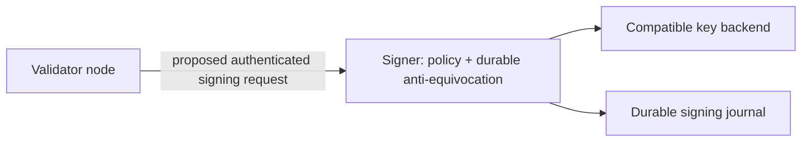

# Remote validator signer proposal

**Status: unimplemented integration design; reviewed 2026-10-18.**

`aether-node` currently signs locally. There is no remote-signer server, runnable
remote-signer container, supported remote-signing configuration section, or
HSM/KMS adapter in the node assembly. Existing KES and signing libraries do not
establish a remote key lifecycle. See [architecture](../architecture.md) and
[`crates/node/src/hybrid_node.rs`](../../crates/node/src/hybrid_node.rs).

This proposal defines requirements before a remote signer can replace local
keys. It is not an operator deployment runbook.

## Goal and boundary

Move validator signing secrets behind an authenticated service and keep an
independent, durable record of messages signed. A compromised node must not be
able to obtain arbitrary signatures or erase prior signing decisions.

Every edge above is proposed. No edge is an assembled node connection today.

## Protocol requirements

A versioned request must identify the chain/genesis, signature algorithm,
validator key, message role, slot, block hash and canonical signing payload.
The signer must reconstruct and validate the exact bytes used by the consensus
verifier. Signing a caller-supplied opaque digest without role/chain binding is
insufficient. Responses must identify the key, algorithm and request digest;
clients must verify the returned signature before use.

The implementation needs authenticated encrypted transport, request size and
rate limits, deadlines, deterministic retry/idempotency semantics, health and
public-key discovery. mTLS and gRPC are candidate designs, not an existing wire
contract. Do not infer a usable protobuf API or TOML key from this proposal.

## Anti-equivocation and crash consistency

1. Define prohibited message combinations from the actual `HybridConsensus`
   vote/proposal semantics. Do not import another protocol's surround-vote rule
   without deriving it for this consensus engine.
2. Atomically persist an authorized signing decision before returning a
   signature. A conflicting request must fail across restart and failover.
3. Repeating an identical request should return the same authorized result;
   uncertain responses must not permit a conflicting replacement.
4. Bind all signing history to chain/genesis and validator key. Key rotation,
   journal restoration and operator recovery must preserve safety.
5. An HA deployment needs a single consistent signing authority or a proven
   coordinated journal. A load balancer in front of independent signer databases
   can double-sign and is not a safe failover design.

## Key backend compatibility

Consensus uses BLS12-381 and VRF keys, while transactions use Ed25519. A generic
P-256/ECDSA signing endpoint is not a drop-in replacement. Validate algorithm,
encoding, domain and key-export policy for each backend before choosing an HSM
or cloud KMS. Vendor branding alone does not establish BLS/VRF compatibility.

Secrets, certificate provisioning, rotation and backup require separate operator
procedures. Logs should record request identity and decisions without exposing
secret keys or unnecessarily retaining sensitive payloads.

## Required E2E acceptance journey

- Start a node with a real signer service and the intended compatible backend;
  finalize blocks on the four-validator devnet.
- Reject unauthenticated requests, wrong chain/role, unknown key and malformed
  payloads; verify returned signatures with the node's normal verifier.
- Retry an interrupted response, then attempt a conflicting same-slot request;
  confirm persistent rejection before and after signer restart.
- Exercise journal recovery, key rotation, concurrent requests and failover;
  show that two signer instances cannot authorize conflicting messages.
- Measure end-to-end signing latency and finality under signer outage. Define
  operational latency/RTO targets from measurements rather than invented SLOs.

Monitoring should cover decision/error counts, request and backend latency,
conflict rejections, certificate expiry and journal health. Metric names and
alerts must be documented alongside their implementation. An external review
of the signer protocol, key backend and journal is required before relying on
it for validator key isolation.
